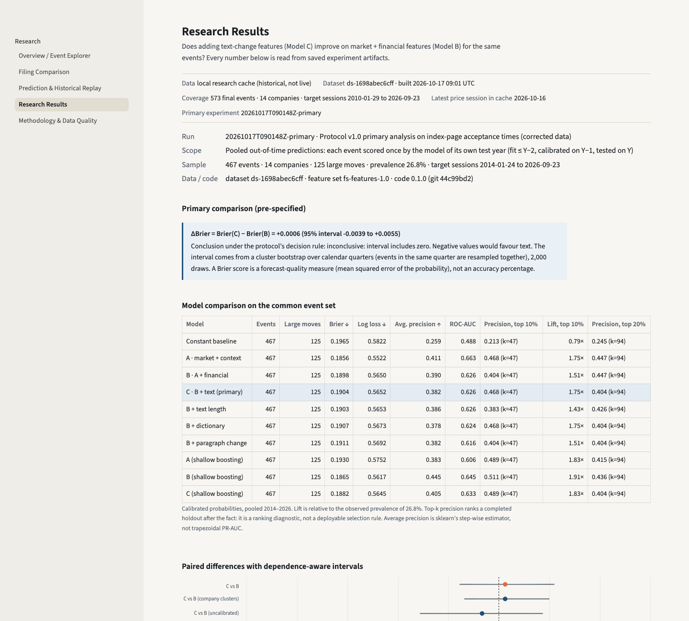
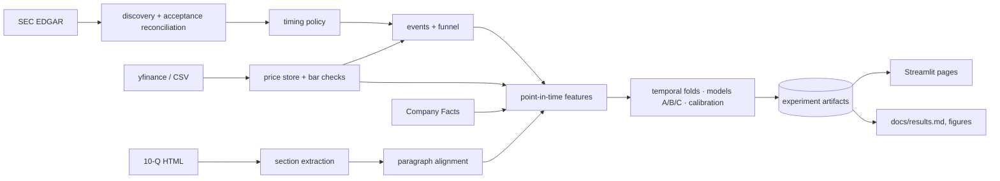

# FilingShock

**Do changes in corporate disclosures improve forecasts of next-session price-move magnitude?**

FilingShock is a reproducible research application. It compares each 10-Q's Management's Discussion and
Analysis (MD&A) with the same quarter one year earlier, builds market, financial and text-change features
using only information available 30 minutes before the next session opens, and tests whether the text
features improve a calibrated probability of an unusually large open-to-close move.

**Current answer (pre-specified primary analysis): inconclusive — no measurable incremental value from text.**
On 467 out-of-time events (14 software companies, 2014–2026), adding text features changed the Brier score
by **+0.0006 (95% interval −0.0039 to +0.0055)**; negative values would favour text. Details in
[docs/results.md](docs/results.md).



## What is implemented

* SEC EDGAR ingestion (submissions, filing index pages, 10-Q documents, Company Facts) with a declared
  User-Agent, throttling, caching, bounded retries, a retrieval manifest with SHA-256 hashes, and resumable steps.
* **Acceptance-time reconciliation**: the submissions API's `acceptanceDateTime` was found to be wrong
  (exactly +4 h/+5 h) for 1,068 of 2,834 checked filings; timing uses each filing's index page instead.
* Market-data provider interface (yfinance, CSV import for licensed or delisted data) with bar-quality checks
  against the XNYS calendar.
* Explicit timing policy: availability proxy, decision cutoff, holidays, early closes, DST.
* Deterministic MD&A / risk-factor extraction with status semantics (extracted, no material changes, short
  reference, absent, failed), manually audited.
* Explainable one-to-one paragraph alignment (added, removed, minor/substantial edit, moved, numbers changed).
* Point-in-time financial features (no later restatement can reach an earlier event), point-in-time
  Loughran–McDonald word lists, interpretable text-change features, a feature catalog.
* Eligibility funnel, event uniqueness, constant/A/B/C models with ablations, temporal folds with separate
  fit/selection/calibration/test blocks, Platt calibration, quarter-clustered bootstrap intervals.
* Saved, reconcilable experiment artifacts; an append-only, hash-chained prospective forecast ledger.
* A five-screen Streamlit interface; an offline sample package; 77 offline tests.

## Data coverage (dataset `ds-1698abec6cff`)

| Stage | Remaining | Main exclusions |
|---|---|---|
| Periodic reports discovered (21 companies, 2010-01-01 → 2026-09-30) | 1,282 | — |
| Original 10-Q | 940 | 314 10-Ks, 28 amendments |
| Accepted after the prior close and available by the cutoff | 758 | 180 accepted during trading, 2 late pre-market |
| One event per company and session | 757 | 1 duplicate |
| Valid prices and 60-session history | 579 | 178 from 7 acquired/delisted companies (no free prices) |
| MD&A extracted | 579 | — |
| Prior-year same-quarter reference usable | **573** | 6 without a reference |

467 of the 573 events receive out-of-time predictions (test years 2014–2026; 2010–2013 are training and
calibration data only); 125 of them are large moves (prevalence 26.8%).

## Quick start

```bash
python3.11 -m venv .venv && .venv/bin/pip install -r requirements.lock.txt && .venv/bin/pip install -e . --no-deps
```

Offline demonstration (no network, no retraining; SEC-derived content only):

```bash
.venv/bin/filingshock app --sample
```

Full research pipeline (network; set your own SEC contact first — the shipped value is a placeholder):

```bash
export FILINGSHOCK_SEC_USER_AGENT="Your Name your.email@example.com"
```

```bash
.venv/bin/filingshock reproduce
```

`reproduce` runs `discover → prices → resources → build → experiment → verify-artifacts`. Each step is
cached and resumable; re-running a completed step does not re-download unchanged files. Other commands:
`validate-setup`, `audit --event <id>`, `audit --timestamps N`, `sensitivity`, `report`, `demo-prepare`,
`forecast-pending`, `score-prospective`. A small pilot: `filingshock discover --pilot` followed by `build`.

Prospective forecasts (live, outside the research sample): `filingshock discover --refresh`, refresh prices
through the previous session with `filingshock prices --refresh --history-end today` (the config's fixed
`market_data.history_end` stays the research default; bars of sessions not yet closed + 60 min are never
stored), then `filingshock forecast-pending`. It records P(large move) from production models A, B and C plus a matured-training-prevalence constant
(fit ≤ Y−2, calibrated on Y−1) in `data/forecasts/prospective_forecasts.jsonl`, only before the decision
cutoff. After the target session, refresh prices again and run `filingshock score-prospective`: it scores
each matured record against the threshold stored in it and appends realized |move|, y and Brier B/C to
the separate hash-chained `data/forecasts/prospective_outcomes.jsonl` (never overwritten, never part of the
research metrics). The Results page shows them per record, and a pooled prospective Brier from 20 scored
events on.

## Demonstration flow

1. **Overview / Event Explorer** — the question, data version and freshness, filters (persist across pages),
   all 1,282 discovered reports including excluded ones with reasons; select an event.
2. **Filing Comparison** — prior-year quarter (left) vs current (right), changed paragraphs by default,
   word-level view, search, topic filter, stacked layout for narrow screens, SEC source links.
3. **Prediction & Historical Replay** — information at the cutoff, the saved Model C / B / constant
   probabilities with the threshold, coefficient attributions, then "Reveal realized outcome". Rule-based
   demonstration cases include mistakes.
4. **Research Results** — primary ΔBrier, model table, paired differences, calibration, per-year stability,
   sensitivity runs, eligibility funnel with record inspection, downloads.
5. **Methodology & Data Quality** — answers to "what, when, which information", extraction and timing
   quality, the timestamp reconciliation, price coverage, feature catalog, limitations.

## Target

For the target session: r = close/open − 1, a = |r|, m = mean |open-to-close| over the previous 60 valid
sessions (all before the cutoff). **y = 1 if a > 2m.** Magnitude only. Overnight gaps and intraday ranges
are excluded. Lookback and multiplier are fixed in the protocol; 1.5× and 2.5× are sensitivity analyses.

## Model comparison (calibrated, pooled out-of-time, 467 events)

| Model | Features | Brier ↓ | Avg. precision ↑ | ROC-AUC |
|---|---|---|---|---|
| Constant | training event rate | 0.1965 | 0.259 | 0.488 |
| A | market + context | **0.1856** | **0.411** | **0.663** |
| B | A + financial | 0.1898 | 0.390 | 0.626 |
| C | B + text | 0.1904 | 0.382 | 0.626 |

All four use the same events, folds, preprocessing, five-setting tuning budget and calibration (L2 logistic
regression; shallow gradient boosting as a secondary family). Text ablations (length, dictionary,
paragraph change) each change Brier by less than +0.0015 with intervals spanning zero. Neither financial nor
text features improved on Model A in this sample; even A's improvement over the constant baseline in Brier
has an interval that includes zero (−0.0109, 95% interval −0.0241 to +0.0030), although its ranking is
clearly better (average precision 0.411 vs 0.259).

Pre-specified sensitivity analyses were all inconclusive except one subgroup: for 10-Qs **not** released
together with an earnings 8-K (256 events with predictions), text slightly worsened Brier
(+0.0077, interval +0.0002 to +0.0165). This is one of several secondary comparisons and is not adjusted
for multiplicity.

A first run used the unverified API acceptance times (499 events; ΔBrier −0.0005, interval −0.0066 to
+0.0054). It is superseded and kept for transparency; see the [protocol change log](docs/research_protocol.md#change-log).

## Reproducibility

Every run stores its configuration, code version and dirty-file list, dataset manifest (with price and
document hashes), folds, seeds, chosen hyperparameters, coefficients, preprocessing and calibration
parameters, per-event predictions and metrics (`data/experiments/<run_id>/`). Re-running the primary
experiment on the same data reproduced every probability exactly (maximum difference 0.0).
`filingshock verify-artifacts` recomputes the metrics from the saved predictions (50/50 checks pass).
Different BLAS or library versions may shift probabilities at around 1e-6.

## Architecture



Code: `src/filingshock/` — `sources/` (SEC, market), `timing.py`, `discovery.py`, `parsing/`, `reference.py`,
`features/`, `target.py`, `events.py`, `modeling/`, `forecasts.py`, `prospective_outcomes.py`, `audit.py`, `cli.py`, `ui/` (pages read
artifacts only).

## Limitations

Fixed, survivor-heavy cohort; availability times are proxies; 31% of events coincide with an earnings
release; small independent sample; no observed concurrent news; single data vintage; manual audits by one
reviewer; no real prospective forecast recorded yet. Details: [docs/limitations.md](docs/limitations.md).

## License

FilingShock's original source code is licensed under the [MIT License](LICENSE).
Third-party data, SEC filing content, dictionaries, and dependencies retain their respective
terms; the MIT License does not grant additional rights to those materials.

## Data sources and licences

SEC EDGAR (public records); Yahoo Finance via yfinance (not redistributable — never committed; use
`prices --provider csv` for licensed data); Loughran–McDonald Master Dictionary (free for academic research;
not redistributed). See [docs/data_card.md](docs/data_card.md).

## Tests

```bash
.venv/bin/python -m pytest -q
```

77 tests: timing (holidays, early closes, DST, after-hours dissemination), target and past-only threshold,
future-data and target-close mutation through the real event builder, restatements and YTD flows,
extraction (ToC, hidden XBRL, page artifacts, risk semantics), alignment, folds, train-only preprocessing,
calibration isolation, metrics, ledger integrity, prospective scoring (recorded only before the cutoff,
single-event features blind to bars at/after the target session), prospective outcome scoring (stored
threshold, nothing before close + settle, idempotent, research artifacts untouched, partial bars never
stored), interface smoke tests and UI-to-artifact reconciliation.
No test uses the network.

## Documentation

[Research protocol](docs/research_protocol.md) · [Timing policy](docs/timing_policy.md) ·
[Methodology](docs/methodology.md) · [Results](docs/results.md) · [Feature catalog](docs/feature_catalog.md) ·
[Data card](docs/data_card.md) · [Model card](docs/model_card.md) · [Provenance](docs/data_provenance.md) ·
[Extraction audit](docs/extraction_audit.md) · [Limitations](docs/limitations.md) ·
[Design decisions](docs/design_decisions.md) · [State matrix](docs/state_matrix.md) ·
[Implementation evidence](docs/implementation_evidence.md) · [Presentation pack](docs/presentation.md) ·
[Contributing](CONTRIBUTING.md)

## Future work

A pre-specified evaluation rule (interval, decision threshold) for the prospective outcomes once enough
have matured; nearest-prior-quarter reference policy as a separate
experiment; an 8-K / earnings-release study with verified publication times; licensed prices for the
delisted companies; semantic alignment evaluated against the deterministic baseline.
